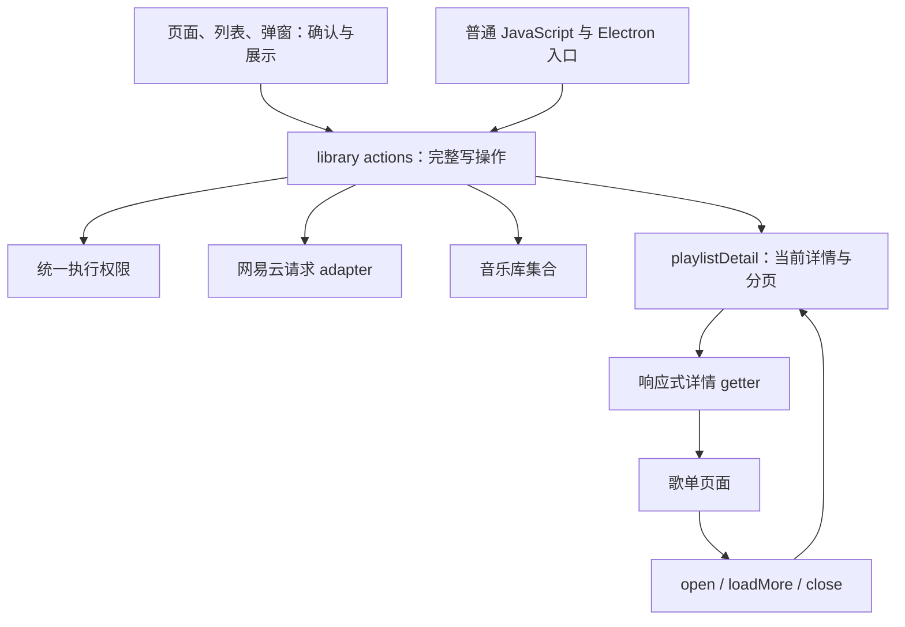

# 音乐库变更与歌单详情：结构设计

**Last Updated:** 2026-10-20

## 当前实现与契约

本文描述当前实现的结构与公开契约，对应[音乐库变更与歌单详情需求](../requirements/library-mutations-refactoring.md)。

以 Vuex `library` 的语义化 actions 作为完整写操作的 interface，以独立 `playlistDetail` module 维护当前歌单详情。调用者提交业务意图，library 统一检查执行权限、解释远端结果、维护音乐库集合，并协调当前详情更新。页面负责确认、提示和展示。

## 当前结构

library 统一执行写权限、远端参数与结果转换、已确认的本地变化和相关数据更新。独立 playlistDetail module 维护当前歌单、完整曲目 ID、读取范围与分页。页面和全局弹窗提交同一套完整操作并消费业务结果，不追加写入后的集合或详情刷新。

TrackList 删除与 TrackListItem 收藏直接调用 library；列表的播放交接见[歌曲行与播放入口](structure-operations.md#歌曲行与播放入口)。



## Library 的公开 interface

### 写操作

以下 actions 均位于 `library/` 命名空间。ID 使用项目已有的资源编号；曲目批次使用 ID 数组，远端参数的转换由 implementation 完成。

| Action | 参数 | 返回值 |
| --- | --- | --- |
| `setPlaylistFavorite` | `{ id, favorite }` | `ChangeResult` |
| `setAlbumFavorite` | `{ id, favorite }` | `ChangeResult` |
| `setArtistFavorite` | `{ id, favorite }` | `ChangeResult` |
| `setMVFavorite` | `{ id, favorite }` | `ChangeResult` |
| `toggleTrackFavorite` | `id` | `ChangeResult` |
| `addPlaylistTracks` | `{ playlistId, trackIds }` | `ChangeResult` |
| `removePlaylistTracks` | `{ playlistId, trackIds }` | `ChangeResult` |
| `createPlaylist` | `{ name, private, trackIds? }` | `CreatePlaylistResult` |
| `deletePlaylist` | `id` | `ChangeResult` |
| `uploadCloudTrack` | `file` | `ChangeResult` |
| `deleteCloudTrack` | `id` | `ChangeResult` |

所有返回值通过 Promise 提供。`favorite` 和 `private` 为布尔值；`trackIds` 在创建歌单时省略或为空表示只创建歌单。调用者无需掌握 `t`、`privacy: 10`、`op`、`pid` 和逗号分隔的曲目 ID。

现有音乐库读取 getters 和加载操作继续承担各自职责。写操作返回业务结果，集合变化通过响应式 getters 提供。

### 结果表达

以下类型描述 interface 的契约：

```ts
type WriteOutcome =
  | { status: 'succeeded' }
  | { status: 'denied'; reason: 'account-required' }
  | { status: 'rejected'; message?: string }
  | { status: 'unconfirmed'; message?: string };

type Synchronization = 'completed' | 'incomplete' | 'not-required';

type ChangeResult = {
  outcome: WriteOutcome;
  synchronization: Synchronization;
};

type CreatePlaylistResult = {
  creation:
    | { status: 'succeeded'; playlistId: number }
    | Exclude<WriteOutcome, { status: 'succeeded' }>;
  addition:
    | WriteOutcome
    | { status: 'not-requested' }
    | { status: 'not-attempted' };
  synchronization: Synchronization;
};
```

- `succeeded`：远端明确确认写入成功。
- `denied`：缺少操作所需的网易云账号会话，未发送写请求。
- `rejected`：远端返回明确的业务拒绝。
- `unconfirmed`：没有取得可确认的写入结果，包括请求返回空结果或运输失败。它不判断远端是否已经执行。
- `completed`：本操作需要的集合和当前详情更新已完成。
- `incomplete`：本操作需要的数据更新未能全部完成。
- `not-required`：本操作没有需要执行的数据更新。

创建时未请求加曲，`addition` 为 `not-requested`；请求了加曲但创建未成功，`addition` 为 `not-attempted`。创建成功后始终保留新歌单 ID，加曲结果与后续数据更新结果分别记录。

远端响应字段和嵌套结构留在 library implementation。普通业务结果使用上述结构，程序错误继续抛出。无结果的处理归属本次 library 操作，现有请求 module 继续承担其请求处理职责。

上传入口将远端包装解为 `{ code, message, track }`；共享写操作根据确认字段判断结果，云盘集合更新直接使用 `track`，不再读取远端包装。

### 执行顺序与完成条件

1. library 在每次写操作执行前读取当前账号权限。访客和公开音乐库浏览身份获得 `denied`，不发送写请求。
2. implementation 转换业务参数并调用远端 adapter，解释本次写入结果。
3. 远端确认成功后，保留已确认的写入事实，直接应用可以确定的本地变化。
4. 将必要的集合读取与当前详情协作作为独立任务等待。一个更新失败不会阻止其他必要更新的尝试。
5. Promise 在相关更新尝试结束后返回。更新失败以 `incomplete` 表达，已经成功的写入保持 `succeeded`。

创建并加曲沿用一个完整操作：创建成功后按需加曲，再维护相应数据。加曲失败和后续刷新失败都保留已经创建的歌单事实。

页面按身份决定入口展示，执行权限只由 library 判断。library 不调用确认框、toast、路由或 Vue 页面实例。

## 当前歌单详情的 interface 与归属

`playlistDetail` 维护一个当前打开的歌单。页面通过 `playlistDetail/current` getter 读取响应式视图，包含 `playlist`、`tracks`、`loading`、`loadingMore` 和 `hasMore`。没有打开详情时，当前详情为空。调用者按只读方式使用视图及其嵌套数据。

| Action | 职责 |
| --- | --- |
| `playlistDetail/open(id)` | 打开目标歌单，加载元数据与首批曲目，并组织现有首屏所需的后续加载 |
| `playlistDetail/loadMore({ count })` | 加载后续曲目，内部管理读取位置；普通加载使用 100，搜索扩展使用 500 |
| `playlistDetail/close()` | 释放当前详情 |

读取操作的 Promise 覆盖对应加载，读取失败交给页面的读取错误处理。页面在进入或变更目标歌单时调用 `open`，离开时调用 `close`。打开另一歌单或关闭详情后，旧详情请求的结果不能写入新的当前详情。

implementation 管理有序曲目 ID、已经遍历的 ID 范围、已加载歌曲、数量和分页状态。分页进度依据已经遍历的 ID，避免把远端实际返回的歌曲数量当作读取进度。

页面保留搜索关键词、输入防抖、焦点、展开描述、菜单及过滤后的展示。播放时从详情视图取得完整曲目 ID。页面不再维护另一份详情或分页游标。

### 写操作与详情协作

library 通过内部协作 interface `playlistDetail/applyLibraryChange(change)` 将已确认的变化交给 playlistDetail。该 interface 属于两个 module 之间的 implementation 协作；UI 只调用 library 写操作。

| 变更 | 当前详情的处理 |
| --- | --- |
| 删除曲目 | 移除匹配的完整 ID 与已加载歌曲，按实际移除数量更新计数，调整已遍历范围并重新计算 `hasMore` |
| 添加曲目 | 重读匹配详情，采用远端曲目顺序，恢复原有加载范围所需的数据量 |
| 收藏歌单 | 应用已确认的收藏状态，并组织相关元数据读取 |
| 删除歌单 | 清空匹配详情，页面根据写入结果执行返回导航 |
| 收藏歌曲 | 维护喜欢歌曲集合与预览，并协调匹配的“喜欢的音乐”详情 |
| 创建歌单、云盘变更及其他收藏 | 更新对应音乐库集合，仅在确实影响当前歌单时参与详情协作 |

详情仅处理与当前歌单匹配的变化。添加后不能凭曲目 ID 推断远端排序，也不能将旧歌曲数组直接拼接到新的 ID 列表上。同步未完成时保留已确定的信息，并通过操作结果表达更新情况。

恢复原加载范围时，旧资料仅用于按新 ID 顺序保留已知展示内容，不能推进已遍历范围。补读失败保留实际成功请求确定的游标，下一次 `loadMore` 从该游标继续；成功请求中缺少详情的 ID 仍计入已遍历范围。

当前歌单与“喜欢的音乐”页面使用单个活动详情。直接的 module 协作集中变更知识，无需让页面订阅写操作或让全局弹窗通知父页面。

## 调用者使用方式

列表删除歌曲：

```js
if (!confirm(`确定要从歌单删除 ${track.name}？`)) return;

const result = await this.$store.dispatch('library/removePlaylistTracks', {
  playlistId: this.id,
  trackIds: [track.id],
});

showLibraryChangeFeedback(
  this.$store,
  result,
  locale.t('toast.removedFromPlaylist')
);
```

全局添加弹窗调用 `library/addPlaylistTracks`，根据写入结果关闭弹窗和提示。当前详情的更新包含在这次操作中。

创建弹窗根据 `creation` 处理创建结果，根据 `addition` 处理加曲结果。创建成功后的音乐库筛选由展示层调用[设置设计](settings-and-persistence.md)中的 `preferences/setLibraryPlaylistFilter`。

Player、歌词页、TrackList、TrackListItem 和 Electron 入口均调用 `library/toggleTrackFavorite`。展示入口消费结果并提供相应反馈。`describeLibraryOutcome` 这样的展示函数只负责文案映射。

专辑、歌手和 MV 页面根据业务结果更新自身展示状态。歌单详情的数据维护统一交给 playlistDetail。

## 文件职责与调用面调整

| 位置 | 当前职责 |
| --- | --- |
| `src/store/modules/library.js` | 完整写操作、执行权限、业务结果、音乐库集合与详情协作 |
| `src/store/modules/playlistDetail.js` | 当前详情、读取与分页、写入后的详情一致性 |
| `src/application/library.js` | 生产请求 adapter 的装配与注入 |
| `src/store/index.js` | 装配 library 与 playlistDetail，连接所需依赖 |
| `src/views/playlist.vue` | 详情生命周期、搜索与展示、确认、提示和导航 |
| `src/components/TrackList.vue` | 调用完整操作，移除 `$parent.removeTrack` 及远端结果判断 |
| `src/components/TrackListItem.vue` | 收藏直接调用 library，移除 `$parent.toggleTrackFavorite` |
| `src/components/ModalAddTrackToPlaylist.vue` | 提交添加意图，依据业务结果展示 |
| `src/components/ModalNewPlaylist.vue` | 提交创建及可选加曲意图，分别消费两个结果 |
| 专辑、歌手、MV 页面 | 使用统一结果，移除重复的执行前权限检查 |
| 音乐库页面、Player、歌词页、Electron 入口 | 共用上传、收藏等完整操作与结果 |

公开调用一次性替换为新的 interface，移除重复编排。普通 JavaScript 与 Vue 页面使用同一个 store 中的 actions。

## 依赖与验证设计

权限判断、参数和结果转换、集合更新及详情计算属于 **in-process**，使用直接函数和实际 Vue/Vuex 状态。

网易云属于 **true external**。沿用应用装配的注入位置：生产 adapter 使用实际请求函数，测试 mock adapter 提供受控响应。业务结果解释与操作编排保留在 module implementation，生产和测试 adapter 共用同一套逻辑。

有效测试从公开 actions 和 getters 验证完整行为；确认框、提示与导航通过关键页面集成验证。有效测试依据本文编写，过时目录中的测试继续作为归档。

| 验证场景 | 可观察结果 |
| --- | --- |
| 访客、公开音乐库浏览身份及网易云账号会话调用写操作 | 权限规则一致，未授权时不发送远端写请求 |
| 远端返回不同成功字段、业务拒绝或空结果 | 调用者得到明确业务结果，无需读取协议字段 |
| 创建成功、加曲失败 | 返回创建成功与歌单 ID，并独立表达加曲结果 |
| 写入成功、相关读取失败 | 保留写入成功，更新结果为 `incomplete` |
| 删除已加载曲目后继续分页 | 完整 ID、歌曲、数量和下一批读取一致 |
| 搜索扩展加载后删除曲目 | 过滤展示及后续分页使用同一份有效详情 |
| 全局弹窗添加到当前歌单 | 等待同一次写操作后，可通过详情 getter 观察更新 |
| 修改其他歌单 | 当前详情不受影响 |
| 关闭或更换当前详情后旧读取完成 | 旧结果不覆盖当前详情 |
| 页面与普通 JavaScript 入口执行相同操作 | 共用权限、结果解释及数据更新流程 |

## Depth、locality 与 seam placement

**Depth** 来自完整操作：调用者只掌握业务意图和结果，权限、远端格式、创建加曲及数据同步均在 implementation 中。动作数量反映已有业务操作，不要求调用者学习额外命令协议或资源对象生命周期。

**Locality** 分别集中在两个维护者：library 管理写规则与音乐库集合，playlistDetail 管理详情读取、分页及变更后的数据一致性。页面保留展示知识。

**Seam placement** 位于 library 的完整写操作以及 playlistDetail 的读取 interface。二者通过内部直接协作连接，远端 adapter 位于 implementation 内部的 seam。删除这些 module 后，权限、协议解释及详情协调会重新分散到页面、列表、弹窗和普通 JavaScript 调用者，因此它们提供实际 leverage。
