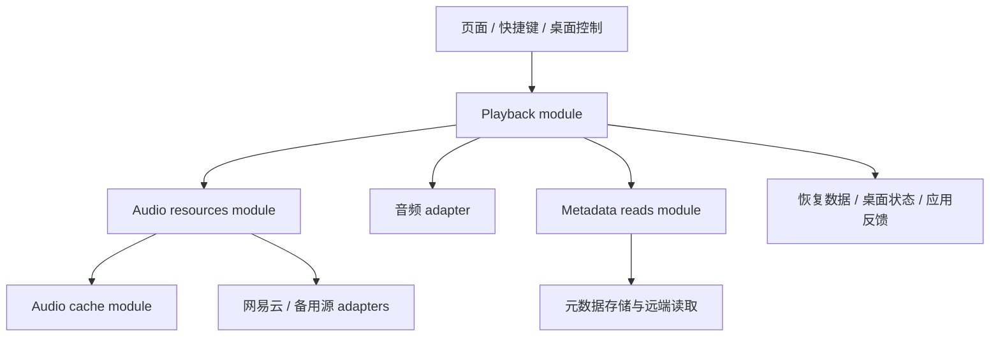

# 播放与音频资源：结构设计

## 设计目标

本文定义播放系统的结构与交接，对应[播放与音频资源需求](../requirements/playback-and-audio-resources-refactoring.md)。行为范围与验收要求由需求文档统一维护。

采用面向常见调用者的直接操作 interface。页面、快捷键与桌面控制表达用户动作，Playback module 完成选曲、资源取得、音频切换与状态交接。取源、音频缓存和元数据缓存读取各自形成完整 module。

## 职责与交接



| Module | 持有与负责的内容 | 调用者获得的能力 |
| --- | --- | --- |
| Playback | 当前播放操作、队列、播放模式、私人 FM、当前音频及资源、公开状态、保存与同步触发 | 完整播放操作与只读状态 |
| Audio resources | 来源选择、来源信息、后台缓存发起、数据预取 | 音源描述与预取完成 |
| Audio cache | 音频记录、容量统计、写入、淘汰与清空的完成顺序 | 完整缓存读写与维护操作 |
| Metadata reads | 歌曲详情、歌词、云盘歌词、专辑的缓存读取与远端刷新 | 保持各自数据含义的读取操作 |

队列运算、随机与循环规则是 Playback 的内部 implementation，使用普通函数组织。应用装配提供实际 I/O adapters；业务调用者无需组合这些依赖。

## Playback 的公开 interface

### 操作

以下为 JavaScript interface 的方法。可选参数使用对象，已有播放来源保留在 `source` 中。

| 方法 | 参数与用途 |
| --- | --- |
| `playPlaylist(id, options)` | 歌单播放；options 包含 `startTrackId`、`fresh`，后者承接已有绕过歌单缓存的选择 |
| `playAlbum(id, options)` | 专辑播放；可指定 `startTrackId` |
| `playArtist(id, options)` | 歌手歌曲播放；可指定 `startTrackId` |
| `playIntelligencePlaylist(id, options)` | 心动模式播放；可指定 `startTrackId`、`fresh` |
| `playTracks(trackIds, options)` | 播放调用者已有的 ID 集合；options 包含 `source`、`startTrackId` |
| `playQueuedTrack(id, options)` | 选择现有队列歌曲；options 区分主队列与下一首列表，承接已有选择规则 |
| `playPersonalFM()` | 进入私人 FM，并执行已有播放或切换动作 |
| `play()`、`pause()`、`toggle()` | 控制当前音频 |
| `next(options)`、`previous()` | 切换歌曲；普通播放与私人 FM 的适用规则由 module 判断；FM 卡片用 `next({ personalFM: true })` 明确选择私人 FM 下一首 |
| `discardFMTrack()` | 完成私人 FM 丢弃当前歌曲的流程 |
| `seek(seconds)` | 调整播放位置及相应平台输出 |
| `setVolume(value)`、`toggleMute()` | 调整音量、静音及恢复静音前音量 |
| `cycleRepeat()`、`toggleShuffle()`、`setReversed(value)` | 修改播放模式，内部执行私人 FM 的已有模式限制 |
| `enqueueNext(id, options)` | 加入下一首列表；`options.playNow` 表达已有立即播放选择 |
| `removeNext(index)`、`clearNext()` | 修改下一首列表 |
| `applyOutputDevice()` | 应用已保存的输出设备设置 |

未指定起始歌曲时使用已有首曲规则。调用者传入的 ID 集合由 module 接收并建立自己的集合，后续外部修改不会改变内部队列。

替换主队列保留下一首列表；清空下一首列表由 `clearNext()` 表达。

### 读取

`playback.state` 提供只读响应式快照，包含：

- 当前歌曲、播放来源、是否启用及实际播放状态。
- 进度、时长、音量、循环、随机和倒序状态。
- 私人 FM 的展示资料与加载状态。
- 当前音源的 `sourceInfo`，供页面生成来源提示。

`upcoming(limit)` 提供有限长度的待播条目，包含歌曲 ID、主队列或下一首列表的分组信息，以及删除下一首条目所需的位置。私人 FM 条目另含 `personalFM: true`，将该条目传给 `playQueuedTrack` 时选择对应推荐。它与实际下一首选择共用规则，调用者按返回顺序展示。

`position()` 读取即时音频位置，供需要即时值的歌词和桌面入口使用。普通进度展示使用响应式快照。

公开快照的数组和嵌套资料与内部可变状态断开引用。Vue 接合使用私有响应式容器保存不可变快照，在公开状态变化时替换快照；内部音频实例和任务留在闭包或私有 implementation 中。快照从内部状态生成，调用者通过操作修改状态。

### 完成、失败与反馈

选曲操作返回 Promise，结果包含以下状态：

| 状态 | 含义 |
| --- | --- |
| `completed` | 本次音频交接及相应状态更新完成 |
| `superseded` | 本次操作已被更新的播放选择取代 |
| `unavailable` | 本次目标无可用音源，module 已按原有规则发起对应处理 |
| `failed` | 本次请求或播放准备失败，携带可识别的原因 |

选曲 Promise 不等待持续播放结束、预取或后台缓存。音频交接后发生的错误通过装配时注入的反馈接收函数报告。无音源与请求失败保留各自处理路径；调用者无需根据返回结果自行跳歌。

应用反馈是面向用户提示的唯一出口。Promise 结果供需要等待的调用者和测试读取；页面不重复提示。被取代的操作安静结束。

### 调用示例

```js
playback.playPlaylist(playlistId);

playback.playTracks(trackIds, {
  source: { type: 'url', id: '/daily/songs' },
  startTrackId: trackId,
});

playback.next();
playback.setVolume(value);

const rows = playback.upcoming(100);
const details = await getTrackDetail(rows.map(row => row.trackId).join(','));
```

待播页面负责取得展示资料并按 `rows` 呈现，队列计算归 Playback。

## 完整播放操作的归属

每次改变播放目标的外部操作在入口建立递增编号，先于歌单、专辑、歌手或心动列表读取。该编号贯穿列表解析、歌曲资料、取源和音频交接。

同步部分按调用顺序执行，网络阶段可以重叠。每次异步完成、修改当前队列或歌曲、发布歌曲资料，以及执行失败处理前，核对编号仍属于当前操作。

自动跳歌和重新取源携带原操作归属，使用内部流程继续执行。它们不能通过重新调用外部播放入口取得新编号。重复选择同一歌曲也使用不同编号，归属判断不依赖歌曲 ID 相等。

音频回调同时关联其音频实例和操作编号。已经失效的实例不能发布播放状态、触发跳歌或覆盖进度。音量与模式修改不取得选曲归属。

最新操作最终失败时，Playback 交付旧实例的最终上报事件并释放仍持有的音频，清空当前音源，将实际播放状态设为停止、进度归零，再交付失败反馈。空列表或无效选择以 `unavailable` 结束时，若仍持有归属已过期的旧音频，也执行相同收束；无音源的自动跳歌和反馈继续使用各自处理路径。过时操作只结束自身任务。

## 音频资源与音频 adapter

Audio resources 的 interface 为：

```js
resolve(track); // Promise<Descriptor | null>
prefetch(track); // Promise<void>
```

`Descriptor` 表达远端地址或音频字节，并携带来源信息。`null` 表达无可用音源，请求失败走拒绝路径。实际来源顺序、条件与失败策略依据需求文档实现。

`resolve` 与 `prefetch` 共用来源解析 implementation。预取只执行数据准备及符合既有条件的缓存操作；后台错误在资源与缓存职责内收束。

音频 adapter 封装 Howler、音频事件、输出设备应用和临时音频地址。它将有效 descriptor 转为本次播放所持有的音频与释放能力。Playback 是当前音频及其资源的唯一持有者。

资源交接顺序为：

1. 取得 descriptor，核对操作归属。
2. 为有效操作准备新音频资源；失败时释放本次准备的资源。
3. 在替换当前音频的交接点卸载旧音频，解除其回调，再释放旧临时地址。
4. 将新音频及资源作为当前持有对象，执行已有自动播放和设备应用规则。
5. 后续替换或释放时，通过幂等释放函数归还该对象持有的资源。

音频装配中的异步步骤继续核对归属。准备期间失效的操作只释放自己取得的资源。普通远端 URL 无需撤销，字节来源创建的 Blob URL 按实际地址撤销。

## 音频缓存的提交与统计

Audio cache 集中提供读取、下载后写入、容量查询、初始化统计、淘汰和清空操作。网络下载并行进行，完成后的数据库修改进入同一个内部串行提交流程。

一次写入的流程为：

1. 开启数据库事务，读取同 ID 的旧记录。
2. 写入新记录，按新旧字节差额计算容量变化。
3. 按既有写入时间顺序删除所需记录，将删除容量计入本次变化。
4. 等待事务成功，再发布新容量并完成操作。

事务失败时保持上次成功的容量统计，失败任务结束后允许后续提交继续。下载不占用数据库事务或提交队列。

初始化扫描、容量统计查询和清空也在该流程中协调，避免较早的扫描结果覆盖较新的写入。缓存清空协调全部目标表，在清空完成后发布音频容量归零。尚未完成下载的任务在下载完成后进入正常提交顺序。

设置清缓存与设置页容量查询通过这些完整操作接入，调用者无需单独修正统计。可用音源的播放与后台缓存提交分开完成。

## 元数据缓存读取

Metadata reads 保留歌曲详情、普通歌词、云盘歌词和专辑的具体读取入口。内部使用同一个读取流程：

1. 读取缓存。
2. 命中时立即返回该类型的缓存结果，并启动一次后台远端刷新。
3. 未命中时等待本次的一次远端读取。
4. 将缓存写入纳入对应异步处理，统一接收后台刷新和写入失败。

具体读取 implementation 负责歌曲 ID 顺序、privileges、可播放状态映射、云盘请求参数与专辑转换。共享 helper 只组织读取顺序和后台失败处理；各次调用独立执行。

音频缓存与元数据缓存使用各自的存储操作和策略。元数据读取的外部函数名称可沿用现有入口，重复编排从各入口收回内部 helper。

## 恢复数据、桌面状态与应用反馈

Playback 在明确的状态转换处调用注入的输出函数。输出投影分别构建：

| 输出 | 内容与触发 |
| --- | --- |
| 恢复数据 | 队列、索引、随机队列、下一首列表、模式、音量及静音前音量、播放来源、当前歌曲、启用状态、私人 FM 资料等持久化内容发生变化时保存 |
| 进度 | 保留既有进度采样、存储和同步节奏，避免每次采样重写整个队列存档 |
| 桌面状态 | 歌曲资料、实际播放状态、模式、进度和当前歌曲收藏状态发生相应变化时交付 |
| 应用反馈 | 操作中确定的失败及后续有效音频错误，使用共同的原因表达交付 |

`player` 恢复投影由 `playerStorage.js` 的 allowlist 维护：`_enabled`、`_repeatMode`、`_shuffle`、`_reversed`、`_volume`、`_volumeBeforeMuted`、`_list`、`_current`、`_shuffledList`、`_shuffledCurrent`、`_playlistSource`、`_currentTrack`、`_playNextList`、`_isPersonalFM`、`_personalFMTrack`、`_personalFMNextTrack`。`restoreSaved()` 读取该投影及独立的 `playerCurrentTrackTime`，通过带操作归属的 `restore` 准备暂停音频；冷启动 FM 推荐加载沿用同一归属。音频实例、Blob URL 和任务由运行过程建立。

桌面输出覆盖歌曲资料就绪等有用中间状态和音频事件。临时字段更新只影响必要的公开展示。保存与同步在具体状态转换处选择，不挂在所有方法的统一结束回调上。

收藏属于 library。应用装配订阅收藏集合变化，根据当前 Playback 状态和 library 数据重新生成桌面收藏投影。

## 依赖与启动装配

| 依赖 | 类别 | Adapter 与验证方式 |
| --- | --- | --- |
| 队列、模式、操作编号和投影 | In-process | 使用真实 implementation，通过公开操作验证 |
| IndexedDB、localStorage | Local-substitutable | 实际 Dexie 与存储代码；测试使用本地 IndexedDB 替代环境和内存存储 |
| 网易云、备用音源、音频下载 | True external | 生产请求或 IPC adapter；测试 adapter 控制响应及完成顺序 |
| Howler、Blob URL、音频事件 | 平台依赖 | 实际音频 adapter；测试 adapter 控制事件并记录创建、卸载和释放 |
| 桌面输出、应用反馈 | 平台与应用依赖 | 实际输出函数；测试 adapter 记录可观察结果 |
| 偏好与网易云账号会话状态 | 应用内读取 | 注入读取函数，沿用各自 module 的公开状态 |

这些 seam 位于实际 I/O 或平台差异处。页面使用 Playback 的同一 interface。访客、公开音乐库浏览身份与网易云账号会话的取源分支继续由已有身份含义决定。

生产模块位置与交接如下：

| 位置 | 职责 |
| --- | --- |
| `src/playback/index.js`、`sourceOperations.js` | Playback、来源操作与私有队列；操作编号覆盖完整选择流程 |
| `src/playback/audioResources.js`、`audioAdapter.js` | 来源与预取、Howler 与临时地址的独立持有和释放 |
| `src/audioCache/index.js`、`src/utils/db.js` | 串行缓存提交、真实数据库及下载 adapter；缓存实例由显式配置创建 |
| `src/api/metadataCache.js` 与各元数据 API | 缓存读取编排与各类型转换 |
| `src/application/musicData.js` | 绑定应用的设置与身份读取函数，创建音频缓存并连接容量设置 |
| `src/api/readingContext.js` | 仅保存元数据转换所需的身份读取函数 |
| `src/utils/common.js` 的可播放状态映射 | 通过显式身份资料完成进程内计算 |
| `src/application/player.js` | 构建唯一 Playback，组合存储、上报、平台输出和外部观察者 |
| `src/application/playerStorage.js` | 读取旧字段并投影持久化数据；比较持久化投影、单独保存采样进度 |
| `src/application/playbackReporting.js` | 消费有效实例事件并连接网易云和 Last.fm 请求 |
| `src/application/playbackPlatform.js` | 注册及释放媒体、IPC 和键盘控制，生成桌面及浏览器投影 |

启动装配的关系为：

1. 恢复 store 与配置，配置请求环境。
2. `startup` 建立同一组 `getSettings`、`getIdentity`，交给 `configureMusicData` 和 Playback 装配；数据接线先于会话恢复中的读取，缓存初始化进入其提交顺序。音源读取将设置中的音质显式传给 `getMP3`。
3. 创建 Playback、音频 adapter 及反馈和桌面输出连接。
4. 启动播放器恢复；恢复选曲也携带操作归属，后续用户选择可以取代它。
5. 依照现有应用启动顺序应用恢复设置并挂载页面。

Playback 的 `dispose()` 供装配使用，释放自身创建的计时器、音频回调和当前资源。页面不负责启动或释放共享播放器。

## 调用面调整

| 调用位置 | 调整后的职责 |
| --- | --- |
| 歌单、专辑、歌手、搜索与 TrackList 等播放入口 | 调用具体来源操作或 `playTracks`，提交起始歌曲与来源 |
| Player.vue、lyrics.vue | 读取公开状态，通过操作修改音量、进度与播放模式；来源提示读取 `sourceInfo` |
| next.vue | 使用 `upcoming(limit)`，加载展示资料并按返回顺序呈现 |
| 快捷键、ipcRenderer、既有媒体控制接合 | 调用同一播放方法，`next()` 内部处理模式，`seek()` 替换音频实例访问 |
| preferenceEffects | 通过 `setReversed(false)` 和 `applyOutputDevice()` 应用播放器效果；通过完整缓存操作清理 |
| library 桌面收藏同步 | 由应用装配读取 library 与 Playback，交付桌面投影 |
| application/player 与 startup | 创建实例、连接 adapters、恢复与释放 |

所有播放入口持有 `store.state.player` 的同一公开 facade。`window.yesplaymusic.player` 仅输出可序列化的桌面读取投影，原生 `/player` 从该投影读取；输入控制交由平台接合调用 facade。

### 上报事件交接

Playback 输出 `played`、`before-replace`、`ended` 事件，包含 `operationId`、`instanceId`、歌曲、该实例的来源、即时位置、完整秒数、自然结束标识及 `recordOnce()`。旧实例在正式交接时输出自己的最终快照；后续过时音频回调由操作与实例双重检查收束。

`recordOnce()` 只能在同步事件交付期间取得该实例的一次记录权。应用装配先交付生产上报接合，再调用可选观察者。上报接合在发请求前取得记录权，请求独立完成；网易云和 Last.fm 共用该记录权。实际产品条件集中在[需求中的听歌记录与正在播放](../requirements/playback-and-audio-resources-refactoring.md#听歌记录与正在播放)。

## 验证设计

测试从调用者使用的 interface 进入。真实进程内规则参与测试，外部响应和音频事件由可控 adapters 提供。

| 测试入口 | 关键观察 |
| --- | --- |
| 完整来源播放操作 | 列表、资料、音源与错误乱序返回时，只有当前操作能交接音频、更新状态或执行失败策略 |
| 队列与模式操作 | 普通播放、私人 FM、插队、重复歌曲、随机、循环与倒序选择；待播结果与实际选择一致 |
| Audio resources | 取源顺序、身份与设置条件、无音源和请求拒绝的区别；预取只准备数据 |
| Playback 与音频 adapter | 临时资源创建、旧音频卸载后的释放、创建失败释放及旧回调失效 |
| Audio cache 与本地数据库 | 新增、覆盖、并发提交、事务失败、淘汰、初始化交错及清空后的记录与统计 |
| 四类元数据读取 | 缓存命中、未命中、后台失败的远端请求次数与返回内容 |
| 存储与桌面输出 | 已有存档恢复、明确字段、数组操作保存、临时变化不保存、中间状态与最终状态输出 |
| 应用反馈 | 页面、快捷键、桌面入口及后续音频错误共用反馈，过时操作无提示 |
| Web 与 Electron 接合 | 实际播放、设备应用和桌面调用与 adapters 的接线 |

自动测试使用 `fake-indexeddb` 执行真实 Dexie，音频生命周期测试运行生产 adapter 并控制 Howler、URL 与设备边界。组合测试运行实际来源 API、元数据缓存、音频缓存、资源和应用装配。真实音频与 Electron 能力通过[运行验证入口](../development-environment.md#electron-播放运行验证)检查；测试套件状态与归档位置见[测试组织](../../tests/README.md)。

## 方案选择与取舍

| 方案 | Depth | Locality | Seam placement 与成本 |
| --- | --- | --- | --- |
| 统一命令：`execute`、`snapshot`、`subscribe` | 完整流程藏在命令后，但命令种类和参数仍需学习 | 规则集中，命令分发容易膨胀 | seam 在命令提交处；增加一套命令表达 |
| 按场景组织：曲集 handle、私人 FM、transport、queue | 各场景隐藏完整操作 | 场景内集中，跨组共享操作归属 | seam 在多个操作组处；常见单次调用需要额外对象 |
| 直接操作：本文采用 | 每个用户动作完成完整流程，常见调用直接 | 播放协调集中，资源与存储知识分别集中 | seam 在用户动作处；方法较多，含义直接可发现 |

直接操作 interface 适合当前 Vue 页面与普通 JavaScript 调用者。它的 leverage 来自调用者无需组织列表、音源、音频与输出步骤。删除 Playback 会让这些规则重新散落到多个入口，说明其 depth 来自实际流程封装。

内部职责划分使取源变化集中在 Audio resources，缓存一致性集中在 Audio cache，元数据读取重复流程集中在 Metadata reads。主要迁移成本是整体替换调用面，以及建立能控制异步顺序和音频事件的测试 adapters。
