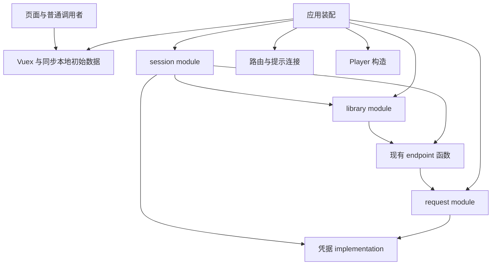

# 会话与请求结果：结构设计

## 设计目标与依据

本设计落实[代码结构重构需求](../requirements/session-and-request-results-refactoring.md)：集中现有规则和完整操作，删除重复编排，理顺依赖，一次性替换相关 interface 和调用者。保留 Vue 2、Vuex、Axios、Web 与 Electron，以及已有存储格式和功能流程。

采用 codebase-design 的 DESIGN-IT-TWICE 方法，由三个独立设计任务分别优化最小 interface、灵活性和最常见调用者，再按 depth、locality 与 seam placement 比较。

分析依据为 `.ua/knowledge-graph.json` 的 419 个节点、802 条边，以及对应源码。graph 的分析提交为 `5d5fa23b7429c82a9932bbc2c9f6036403c5757b`。依赖判断以源码为准，例如 graph 中 actions 指向 store 的一条关系来自已注释的 import。

| 已核实的问题 | 源码依据 | 设计需要解决的结构问题 |
| --- | --- | --- |
| auth 导入 store 和认证请求，request 又导入 auth 与 router | `src/utils/auth.js`、`src/api/auth.js`、`src/utils/request.js` | 凭据读取、会话操作、传输和应用效果相互牵连 |
| store 构造 Player，Player 反向依赖 store，并在构造时请求音源或 FM | `src/store/index.js:56`、`src/utils/Player.js:215` | 初始化顺序依赖 import 执行时机 |
| store 使用 common，common 又依赖 store 和 auth | `src/store/index.js`、`src/utils/common.js` | 外观初始化被卷入会话和网络依赖 |
| 登录页编排凭据、模式、资料、歌单和导航 | `src/views/loginAccount.vue:217`、`src/views/loginUsername.vue:88` | 页面需要了解过多内部步骤 |
| App 与音乐库页面分别组织收藏请求 | `src/App.vue:93`、`src/views/library.vue:318` | 重复编排，加载依赖分散 |
| 身份和用户偏好共用 data，所有 mutation 都写回整个对象 | `src/store/state.js`、`src/store/plugins/localStorage.js` | 数据归属与持久化写入耦合 |
| locale 在导入时读取 store 的设置 | `src/locale/index.js` | 启动重排必须保留同步设置可用性 |

鉴权工具有 19 个直接导入文件，其中 12 个是 Vue 文件。主要读取是账号权限与音乐库身份；`isLoggedIn` 和 `isUsernameLoggedIn` 没有外部调用者。

## 方案 A：最小 interface，封装完整身份流程

提供应用级身份 module，主要 interface 为：

```js
identity.current                    // 只读账号权限、音乐库身份
identity.enter(target)              // phone / email / qr / public-library
identity.leave()
```

`enter` 隐藏认证参数准备、凭据写入、身份更新、资料和歌单加载、提示和导航。二维码返回用于展示扫码状态和停止现有轮询的对象。该返回对象也是 interface 的一部分，不能仅用三个入口衡量复杂度。

典型调用：

```js
const flow = identity.enter({ kind: 'qr' });
// 页面显示 flow.view，销毁时调用 flow.stopPolling()
identity.enter({ kind: 'public-library', user: selectedUser });
identity.leave();
```

Vuex 保持权威状态；该 module 读取同一份状态并封装身份写入。普通歌曲、专辑查询继续使用原 endpoint interface。凭据和 HTTP 通过 internal seam 接入浏览器实现及测试 adapter。

手机与邮箱登录仍按凭据、模式、资料、歌单、导航的顺序执行；退出仍按现有范围本地清理并发出远端请求。二维码停止操作对应现有清理 interval 的含义。请求保持当前业务数据或失败结果，不增加新的错误协议。

**Depth：** 完整进入和退出流程很深，删除 module 会使这些步骤重新散落到页面。

**Locality：** 身份操作集中，但应用导航、二维码交互和不同登录方式都聚集在同一 implementation。

**Seam placement：** 位于用户身份操作入口。对页面很直接；二维码返回对象和 Vue 响应式连接增加实际 interface 成本。

主要代价是四种进入方式形成一个带分支的调用协议；入口少并没有消除每种方式的不同生命周期。

## 方案 B：灵活性，显式装配应用操作

提供普通 JavaScript 应用 module，以具名操作表达不同调用形态：

```js
accounts.identity.read()
accounts.login.password(form)
accounts.login.qr(viewEffects)
accounts.publicLibrary.select(user)
accounts.logout()
accounts.library.startup()
accounts.library.activate()         // { visibleNow, detailsReady }
accounts.refreshDaily()
```

页面获取完整操作，Player 获取只读 identity，路由获取查询，测试通过构造 interface 注入存储、HTTP 和导航 adapter。Vuex 继续保存权威状态，不建立第二份会话状态。

`library.activate()` 显式区分当前已有预览和详情请求完成；其余收藏请求继续独立加载。密码登录保留现有成功链条与提示，二维码操作保留现有启停语义。

该方案把 request 和八个 endpoint module 改为显式构造。request 接收必填的结果处理函数，应用装配负责把内部结果转成原调用者可见结果并执行现有失效效果。所有构造函数不发请求，完成装配后才启动 Player 等工作。

**Depth：** 完整登录和加载流程有较高 leverage，查询 interface 也易于独立使用。

**Locality：** 会话、数据加载、环境传输分别集中，便于局部替换。

**Seam placement：** 脱离 Vuex 调用协议，更适合页面、普通 JavaScript 与测试分别获得最小依赖。

主要代价是构造 interface、endpoint 工厂化和对象装配范围较大。现有项目明确保留 Vuex，这部分灵活性带来的收益有限。

## 方案 C：最常见调用者，Vuex feature module

以 Vuex 作为主要 seam，用 session 和 library 两个 module 承接完整操作和账号数据。页面沿用 `$store`、`mapGetters`、`mapActions`。

```js
store.getters['session/hasAccount']
store.getters['session/hasLibraryIdentity']
store.dispatch('session/loginWithPassword', form)
store.dispatch('session/browseAs', selectedUser)
store.dispatch('session/logout')
store.dispatch('library/loadForApp')
store.dispatch('library/loadForLibrary')
```

session 内部隐藏凭据、认证协议和完整登录流程；library 内部隐藏加载集合、数据依赖和状态写入。应用启动位置连接 HTTP、导航和提示依赖。普通 JavaScript 调用者使用同一 getter，避免新增 auth 转接层。

**Depth：** 入口数量多于方案 A，但每个入口表达现有用户操作，页面无需拼装内部步骤。

**Locality：** 会话规则、完整登录流程和账号加载分别集中在对应 feature 中；Vuex 是唯一响应式状态来源。

**Seam placement：** 与现有调用者的状态读取和操作提交位置一致。代价是普通 JavaScript 调用者也要了解 Vuex interface。

## 比较与推荐

| 维度 | 方案 A | 方案 B | 方案 C |
| --- | --- | --- | --- |
| Depth | 入口少，二维码返回协议较复杂 | 操作完整，构造配置较多 | 具名操作较多，页面认知成本低 |
| Locality | 身份进入流程集中，应用职责聚集 | 各类变化集中，装配分布较广 | 业务与状态共同集中于 feature |
| Seam placement | 用户身份操作 | 普通 JS 应用对象及注入依赖 | Vuex getters/actions |
| 响应式接入 | 需要设计视图连接 | 查询读取 Vuex，另有操作对象 | 直接使用现有 Vuex |
| 外围改动 | 登录页和应用装配较多 | 八个 endpoint 工厂化，范围最大 | 状态消费者和启动接线调整 |
| 主要风险 | 用少数入口隐藏复杂协议 | 为灵活性增加装配成本 | 只搬 actions，未真正收拢流程 |

**推荐方案 C。** 项目保留 Vue 2/Vuex，主要调用者已经使用 Vuex。通过同一 seam 读取状态和执行完整操作，能够获得较高 leverage，也减少额外订阅、镜像状态和依赖对象。

吸收方案 A 的完整操作封装，避免页面调用认证后再手动加载资料；吸收方案 B 的显式依赖装配，但保留现有 endpoint 函数 interface，不将八个 endpoint module 全部工厂化。

## 推荐方案的 interface

以下是具名 interface 草案。每个 action、getter、展示字段和初始化要求都计入 interface 成本。

| 调用者 | Interface | 契约 |
| --- | --- | --- |
| 页面、路由、Player、工具 | `session/hasAccount`、`session/hasLibraryIdentity` getters | 同步查询现有身份规则，不发请求 |
| 密码登录页 | `session/loginWithPassword(form)` | 处理手机/邮箱参数与现有完整成功流程；输入仍留在页面 |
| 二维码登录页 | `session/startQrLogin`、`session/stopQrPolling` | 管理现有 key、轮询与扫码状态；停止操作清理 timer |
| 登录页展示 | session 中的 processing、二维码 URL 与扫码状态 | 只读展示；SVG、焦点和表单校验留在页面；密码不进入持久化 |
| 公开音乐库选择页 | `session/browseAs(user)` | 写身份、定位歌单、执行现有导航流程 |
| 导航栏、设置页 | `session/logout` | 现有本地清理与远端退出顺序；主动退出导航归入操作内的应用协调 |
| App | `library/loadForApp` | 组织当前启动加载集合 |
| 音乐库页 | `library/loadForLibrary` | 组织当前页面加载集合；返回的 Promise 以预览详情链完成为准 |
| 收藏变更调用者 | `library/reloadPlaylists`、`library/reloadLikedPreview`、`library/toggleTrackLike` | 承接现有刷新及喜欢操作，不让调用者拼接请求与集合写入 |
| 数据展示 | library 的 profile、collections、likedPlaylistId getters | 单一数据来源，调用者不直接写入 |

音乐库页已有预览时立即展示，同时调用加载入口；没有预览时等待其 Promise。专辑、歌手、MV、云盘、历史请求不加入决定页面展示的统一 `Promise.all`。

启动恢复和每日 cookie 刷新由应用启动及现有页面激活触发位置调用 module 的应用接线入口；不作为所有页面必须学习的操作。

session 的会话规则与应用协调可以分布在内部文件，但只有统一的 feature interface。导航、提示、认证调用和存储依赖由装配位置提供；规则文件不导入全局 router 或 store。

## 请求与应用效果的连接

保留 `src/utils/request.js` 的调用形状，八个 endpoint module 继续调用 `request(config)`。请求配置集中管理 baseURL、cookie、realIP 与 proxy。凭据读取使用不依赖 store、router 的内部 implementation。

应用在启动时为请求实例安装必填的失效处理函数和设置读取函数。连接完成后才允许启动网络工作；不存在默认空处理函数。该配置只在应用启动位置出现。

失效处理函数调用 session 内部与主动退出共用的清理 implementation，再执行现有失效导航。主动退出和失效处理保留各自导航目的，避免失效时先跳首页再跳登录。两者不通过连续调用两个带导航的公开操作实现。

请求 module 只识别现有 `301` 与 `需要登录` 条件并调用已连接处理函数，不导入会话实现或 router。成功返回业务数据，普通失败维持现有 `undefined` 结果；错误分类、统一 rejection 与失效去重属于独立的行为完善设计。

## 状态与持久化

| 归属 | 数据 |
| --- | --- |
| session | loginMode、现有刷新日期、登录过程展示状态 |
| library | profile、喜欢歌单标识、收藏、云盘、历史及相关账号数据 |
| 用户偏好 | settings、libraryPlaylistFilter 等偏好字段 |
| 既有归属 | Player、Last.fm、曲目缓存 |

内存按职责拆分，磁盘沿用原 data/settings schema。一个持久化 implementation 完成读取拆分与写回合并，保留原对象中的未知字段和动态设置。原 localStorage 插件同步替换，避免两份对象争夺同一存储键。原本未持久化的收藏集合继续保持内存数据。

身份和账号数据通过完整操作修改，页面中的身份 `updateData` 调用删除；偏好修改保留独立入口。退出清理范围沿用现有实现，账号数据的全面重置与旧结果隔离归入行为完善需求。

## 启动与依赖关系



图表示装配和调用方向。request 的失效回调由装配位置提供，源码不反向 import session。以下初始化顺序是 interface 的组成部分：

1. store 的基础构造保持同步本地初始化、现有迁移与 settings 读取，使 locale 顶层读取仍然成立。账号初始数据作为 module 注册的输入保留。
2. 基础 store 不导入 Player、common 或 endpoint。它只包含基础状态、无网络依赖的 mutations/actions，以及本地数据读取 implementation。
3. 应用装配位置导入现有 endpoint 函数，用这些函数及导航、提示依赖创建并注册 session/library module。注册过程不发请求。
4. 安装持久化写回，连接 request 失效效果和设置读取，安装路由守卫。所有连接均在首次导航和网络工作前完成。
5. 应用外观，构造 Player 并安装原 Proxy、存储和 IPC 行为，再执行已有每日刷新并挂载 Vue。App 的加载入口保持原触发位置。

这样 locale 能同步读取 settings，Player 首次请求也有完整的失效处理。现有 `api/track`、db、common 可以暂时继续读取已构造的 store；store 不再反向静态导入这些 implementation，相关循环被切断。

外观函数从混合 common 中移到不依赖 store 的文件；每日刷新移入会话 implementation。Player 算法、缓存算法和桌面生命周期保持原归属。

## 文件与调用面调整

| 文件或调用类别 | 调整 |
| --- | --- |
| `src/features/session/` | module factory、完整操作、私有身份规则和凭据 implementation |
| `src/features/library/` | module factory、加载配方、账号数据与既有变更操作 |
| `src/application/bootstrap.js` | 注册 module、连接请求效果、路由及 Player 初始化 |
| `src/store/persistence.js` | 读取拆分与原 schema 写回；替换旧写入插件 |
| `src/utils/request.js` | 删除 auth/router import；接收应用连接与设置读取 |
| `src/utils/auth.js` | 删除；不保留转发 interface |
| `src/api/auth.js` | 认证 endpoint 供 session implementation 使用，页面不再直接调用 |
| `loginAccount`、`loginUsername` | 删除凭据、身份写入与加载导航编排，保留表单和展示 |
| App、library 页面 | 使用各自加载入口，保留现有展示就绪条件 |
| Navbar、settings | 使用完整退出操作 |
| router | 通过注入查询使用统一身份规则 |
| album、artist、mv、playlist、lyrics、TrackList、DailyTracksCard | 替换身份查询和涉及的数据访问 |
| Player、playList、common、api/artist | 使用同一身份查询；按依赖方向调整必要调用 |
| root actions/mutations/state | 移除已归属 feature 的实现与数据，保留无关功能 |
| ModalNewPlaylist、ModalAddTrackToPlaylist 等集合写入者 | 改用账号数据操作；偏好写入与账号写入分开 |
| 其他 library 数据读取者、桌面同步 | 同步适配数据路径与必要通知，不保留旧状态镜像 |

`updateLikedXXX` 中的 Player IPC 同步不能随 root mutation 删除而丢失：将其作为 library 集合更新后的应用效果连接，保持原触发条件。

## 验证设计

通过公开 interface 使用真实 Vuex module，HTTP 使用受控响应 adapter，cookie/localStorage 使用本地替身。测试与调用者跨越同一 seam。

- 验证现有身份查询、密码登录、二维码流程、公开音乐库选择和退出的可观察状态与导航。
- 验证登录中资料、歌单与导航顺序；保持已有失败路径，不以统一 await 改变错误处理范围。
- 验证 App 与 library 的加载集合差异、喜欢歌单与预览的依赖，以及预览决定页面就绪的条件。
- 验证 request 成功结果、当前失败结果、现有失效处理与环境参数。
- 用存储样本验证拆分读取、原 schema 写回、动态设置和未知字段保留。
- 验证 locale 导入时 settings 可用，Player 首次请求前连接已完成，收藏变更的 IPC 通知仍触发。
- 检查旧 auth interface、重复页面编排、旧写入者和相关循环依赖已删除。

现有 package.json 没有应用测试脚本。实施时选择兼容仓库 Node 14/16 与 Vue 2 的测试配置；新增验证集中在上述 interface，不为每个私有函数建立重复测试。

## 设计结果

采用 Vuex feature module，将页面已有的状态读取方式与完整业务操作放在同一 seam；将初始化和应用效果集中装配；保持请求和 endpoint 的调用形状。设计的主要收益是完整流程的 depth 和维护时的 locality，而非目录数量或抽象层数。
