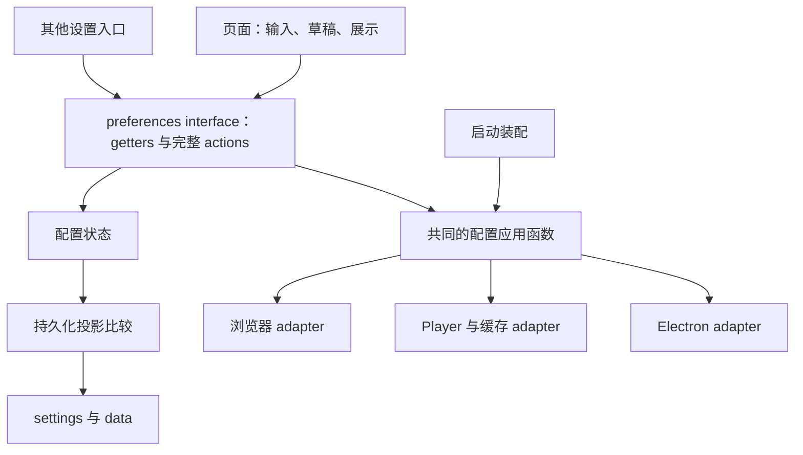

# 设置操作与持久化：结构设计

## 状态与目标

本文定义已确认、待实现的结构设计，对应[设置操作与持久化需求](../requirements/settings-refactoring.md)。

以 Vuex `preferences` 的 getters 和完整 actions 作为 module 的 interface。调用者提交设置意图，module 协调状态更新、选择性持久化和实际应用。纯数据偏好共用修改入口；具有执行流程的设置提供明确命名的操作。

## 当前结构与目标结构

当前 `preferences` 提供设置状态与 mutations，设置页另外组织语言、外观、Player、缓存和 Electron 调用。持久化订阅按 mutation 所属 module 同时写回 `settings` 和 `data`；Electron 设置同步还会触发全局快捷键注册。

目标结构将这些知识收进完整操作。页面保留输入、未提交草稿、按键捕获、展示和提示；启动装配与运行时操作复用配置应用函数。



## 公开 interface

### 读取

保留 `preferences/settings` 与 `preferences/libraryPlaylistFilter` getters，提供响应式配置。调用者按只读方式使用，包括嵌套对象和数组。默认值、已有迁移和取值转换由 implementation 处理，页面读取可用配置。

### 提交

以下名称均位于 `preferences/` 命名空间。mutations 是 implementation，业务调用者通过 actions 提交。

| Action | 参数 | 完整操作 |
| --- | --- | --- |
| `setPreference` | `{ key, value }` | 更新纯数据偏好，包含现有动态设置，执行取值转换与按需保存 |
| `setLibraryPlaylistFilter` | 筛选值 | 更新筛选偏好，按需保存到 `data` |
| `togglePlaylistCategory` | 分类名称 | 更新启用分类并按需保存 |
| `setLanguage` | 语言 | 保存并应用 locale |
| `setAppearance` | 外观模式 | 保存并共同应用外观与主题色 |
| `setThemeColor` | 主题色 | 保存并按当前有效外观应用主题色 |
| `setTrayIconTheme` | 托盘主题 | 保存并应用桌面托盘效果 |
| `setMusicQuality` | 音质 | 保存，实际变更时调用现有缓存清理入口 |
| `setOutputDevice` | 设备 ID | 保存并调用 Player 应用输出设备 |
| `setAutomaticCaching` | 是否启用 | 保存，关闭时调用现有缓存清理入口 |
| `setReversedModeEnabled` | 是否启用 | 保存，关闭时复位 Player 的倒放状态 |
| `setGlobalShortcutsEnabled` | 是否启用 | 保存并结合录制状态应用平台快捷键状态 |
| `submitProxy` | 完整代理配置 | 保存并应用已提交的代理配置 |
| `disableProxy` | 无 | 保存关闭状态并关闭代理 |
| `beginShortcutRecording` | `{ id, type }` | 开始录制的平台控制，返回是否允许开始 |
| `saveShortcut` | `{ id, type, shortcut }` | 保存快捷键并更新相关平台效果 |
| `endShortcutRecording` | 无 | 结束录制的平台控制，按当前配置恢复快捷键状态 |
| `restoreDefaultShortcuts` | 无 | 恢复默认配置并应用菜单与快捷键效果 |

`setPreference` 的字段范围是纯数据偏好。有完整操作的字段由对应 action 负责，不能通过纯数据入口绕过其流程。动态字段与未知字段保持可读写，implementation 不以封闭字段清单裁剪存储。

actions 返回 Promise；`beginShortcutRecording` 的结果为布尔值，其余操作完成后无业务返回值。当前未启用全局快捷键时，开始录制全局快捷键返回 `false`。

### 顺序与完成含义

操作先转换输入、确定变化并更新配置，再保存相应数据并执行依赖新配置的效果。当前 Player 输出设备调用会读取设置，因此配置更新先于该调用。

相同持久化值不重复写回。音质未变时不清缓存；显式提交代理仍执行代理应用，即使保存值没有变化。

Promise 覆盖存储和 adapter 实际能够报告的执行步骤。单向 Electron IPC 的完成点是消息发送；具有异步完成结果的依赖沿调用链返回该结果。可观察到的存储或 adapter 异常沿调用链返回，页面继续负责现有提示和展示。

### 调用示例

```js
await store.dispatch('preferences/setMusicQuality', value);

await store.dispatch('preferences/setPreference', {
  key: 'musicLanguage',
  value,
});

await store.dispatch('preferences/submitProxy', proxyDraft);
```

Vue 页面的 computed setter 只提交对应 action。缓存数量等展示查询仍由页面执行；清理缓存的执行步骤属于设置操作。

## Implementation 的职责

### 配置数据

默认值、已有版本迁移、缺失快捷键补齐、语言推导及现有取值转换集中管理。配置读取保留动态设置和未知字段；嵌套配置更新同样保留已有扩展字段，避免提交表单时覆盖掉未展示的数据。

迁移后的有效配置用于建立 Vuex 状态、启动应用以及后续读取。页面中重复的静态默认值和转换规则移入这份 implementation。

### 配置应用与变更动作

使用普通函数组织应用规则。外观模式与主题色共同调用外观应用函数，自动主题监听也调用同一函数。语言、输出设备、托盘和桌面设置同样各有明确的应用归属。

| 设置类型 | 启动恢复 | 运行时提交 |
| --- | --- | --- |
| 语言、外观、主题色 | 应用恢复的配置 | 使用共同函数应用新配置 |
| 输出设备 | 在 Player 可用后应用；新音源仍使用已有设备应用逻辑 | 更新配置后要求 Player 应用 |
| 音质、自动缓存 | 恢复配置供消费者读取 | 实际音质变更、关闭自动缓存时调用缓存清理入口 |
| 倒放开关 | 恢复配置供 Player 使用 | 关闭时复位倒放状态 |
| 桌面快捷键、托盘 | 通过桌面应用函数恢复 | 按相关设置变化应用；快捷键同时考虑录制状态 |
| 由消费者读取的纯偏好 | 提供恢复后的值 | 保存后供消费者读取 |
| 下次启动使用的设置 | 在相应启动位置读取和应用 | 保存供下一次启动使用 |

Linux 自定义标题栏、OSD 启动选项等保持其已有应用时机。设置提交不增加这些能力的热重载。

### 选择性持久化

`src/store/persistence.js` 负责已有存储格式的读写与持久化投影比较。两个主要投影分别为：

| 存储项 | 当前状态中的持久化字段 |
| --- | --- |
| `settings` | `preferences.settings` 的完整值，含动态和未知字段 |
| `data` | `session.loginMode`、`session.lastRefreshCookieDate`、`library.user`、`library.likedSongPlaylistID`、`preferences.libraryPlaylistFilter`，合并原有未知字段 |

相关状态变化后，分别比较投影与最近一次成功保存的值，变化才写对应存储。比较使用独立值快照，能识别数组或嵌套对象的原地变化。

主题变化只写 `settings`；音乐库筛选或身份持久化字段变化只写 `data`。收藏集合、加载状态和二维码展示不属于持久化投影，不产生这两项写回。session 与 library 继续拥有各自状态，持久化只处理已有字段的保存。

初始化完成默认值补齐和已有迁移后，仅写回有变化的存储项；`appVersion` 在需要更新时写入。

### Electron 设置应用

Electron adapter 分开协调设置镜像与具体平台效果：

- 设置变化时同步主进程需要的设置镜像；筛选偏好变化不发送 settings。
- 镜像同步负责更新保存值，快捷键注册由对应应用函数控制。
- 代理、托盘、菜单和快捷键效果通过完整操作调用。
- 普通设置变化不触发快捷键重新注册。

原 `sendSettings` 订阅与页面 IPC 的职责并入这一流程，设置变更的效果只有一个协调位置。

## 代理提交与已有存储

当前页面逐字段修改 `settings.proxyConfig`，请求配置立即读取这些值；Electron session 代理则等待“更新代理”按钮。这是当前保存与应用时机的分裂。

目标交互由页面持有代理草稿。编辑协议、地址和端口只修改草稿；点击更新调用 `submitProxy`，选择关闭调用 `disableProxy`。提交后，由完整操作更新保存值并应用代理。已有空配置处理由操作内部负责。

保留已有存储表示：renderer 的 `settings.proxyConfig` 为结构化请求配置，主进程的 `proxy` 为已有桌面启动路径使用的代理规则字符串。

桌面启动继续读取 `proxy`，与运行时提交共用主进程的代理应用函数。renderer 恢复 `settings.proxyConfig` 时，不自动把历史上可能未提交的配置覆盖到主进程。下一次完整提交更新这两处已有表示。

## 快捷键录制

页面负责按键捕获、组合字符串、录制对象和录制状态的展示。module 维护平台控制所需的录制状态，协调以下流程：

1. 开始录制时暂停平台全局快捷键。
2. 保存时更新配置、持久化和菜单；录制期间维持平台暂停。
3. 保存后继续录制，页面仍可提交新的按键组合。
4. 点击录制区外或离开页面时调用结束操作，按当前全局快捷键启用配置恢复平台状态。

录制期间的普通设置同步、快捷键保存和默认值恢复，都通过同一个平台应用逻辑处理，保持录制状态与全局快捷键启用配置的一致控制。

## 依赖与启动装配

| 依赖 | 分类 | Implementation 中的使用方式 |
| --- | --- | --- |
| 默认值、迁移、转换、状态和持久化投影 | In-process | 直接组织为普通函数和 Vuex 状态 |
| localStorage | Local-substitutable | 实际 storage adapter；测试使用内存 storage |
| DOM、系统主题、locale | Local-substitutable | 浏览器 adapter；测试使用 DOM 和事件替身 |
| Player 与缓存调用 | Local-substitutable | 注入已有操作；测试记录调用和可观察结果 |
| Electron IPC、主进程存储与桌面效果 | Local-substitutable | Electron adapter；测试使用本地效果替身 |

实际 Web、Electron 差异通过 adapter 表达。普通调用者使用相同的 settings interface；in-process 规则直接位于 implementation 内。设置 module 由装配处获得依赖，不自行构造 Player 或导入全局 store singleton。

`src/main.js` 与 `src/application/startup.js` 负责接线和次序：

1. 读取存储，执行配置默认值和已有迁移，创建 store。
2. 使用规范化语言创建 locale。
3. 配置请求环境，使其读取已恢复设置。
4. 创建 Player，完成设置效果所需的依赖接线。
5. 使用共同的应用函数应用恢复配置，安装系统主题监听。
6. 挂载页面。

启动应用不调用音质变化清缓存等变更动作。桌面窗口创建前需要的配置由主进程从其已有存储读取；renderer 与主进程各自复用实际负责的应用函数。

## 代码职责与调用面

| 位置 | 目标职责 |
| --- | --- |
| `src/store/modules/preferences.js` | 设置读取、完整 actions、内部状态修改与录制平台状态 |
| `src/store/initLocalStorage.js` 及配置数据处理函数 | 默认值、已有迁移与取值转换的集中实现 |
| `src/store/persistence.js` | 恢复持久化状态、比较持久化投影并写回对应存储 |
| `src/application/` | 设置效果的依赖接线、实际 adapter 和启动装配 |
| `src/utils/appearance.js` | 共同外观应用函数与系统主题响应 |
| `src/electron/ipcMain.js` 及相关桌面实现 | 设置镜像与具体平台效果的分别处理，复用桌面应用函数 |
| `src/views/settings.vue` | 输入、草稿、展示、按键捕获与完整操作调用 |

设置页以外的写入调用者一并改用公开 actions：`explore.vue` 的分类选择，`library.vue` 与 `ModalNewPlaylist.vue` 的筛选偏好，以及 `ipcRenderer.js` 的关闭窗口选项记忆。现有设置读取者继续使用 getters。

## 验证设计

新测试通过公开 actions、getters 和启动装配进入，以存储 adapter 与效果 adapter 的可观察结果验证完整流程。

| 场景 | 验证结果 |
| --- | --- |
| 修改外观或主题色 | 读取结果、保存值和实际外观一致；只写 settings |
| 重复提交相同值 | 不重复写存储；相同音质不清缓存 |
| 启动恢复与运行时修改 | 共用配置应用效果；恢复音质不清缓存 |
| 关闭自动缓存或倒放 | 完整操作调用相应清理或复位入口 |
| 默认值、已有迁移与动态设置 | 公开读取结果可用；动态和未知字段保存后保留 |
| 身份字段或音乐库筛选变化 | 只写 data；保留其余已有字段 |
| 收藏集合加载或二维码展示变化 | 不写 settings 或 data |
| 代理草稿编辑与提交 | 草稿不改变已提交配置；提交后完成保存与应用；关闭立即提交 |
| 已有桌面代理恢复 | 使用已有 proxy；renderer 恢复不覆盖历史已应用值 |
| 快捷键录制与保存 | 开始暂停，保存期间维持暂停，结束后按启用配置恢复 |
| 录制期间修改其他设置 | 设置同步不触发快捷键重新注册 |
| Web 与 Electron | 共同设置操作可用；桌面效果由 Electron adapter 执行 |

测试描述目标行为及完整操作的结果，不锁定内部 mutation 名称、函数拆分或文件数量。

## Depth、locality 与 seam placement

外部 seam 直接位于已有 Vuex 读取和写入位置，适合当前 Vue 页面及普通 JavaScript 调用者。命名操作使调用者只需提供业务值，保存位置、执行顺序和平台差异位于 implementation 内，形成 depth。

修改一个具有执行流程的设置时，知识集中在对应 action、共同应用函数和公开测试。纯数据入口减少逐字段转发；默认值、转换和持久化各有集中归属，保持 locality。

Vuex 是这份 interface 的具体形态。内部通过普通应用函数复用规则，通过实际 adapter 提供可替换的依赖。
